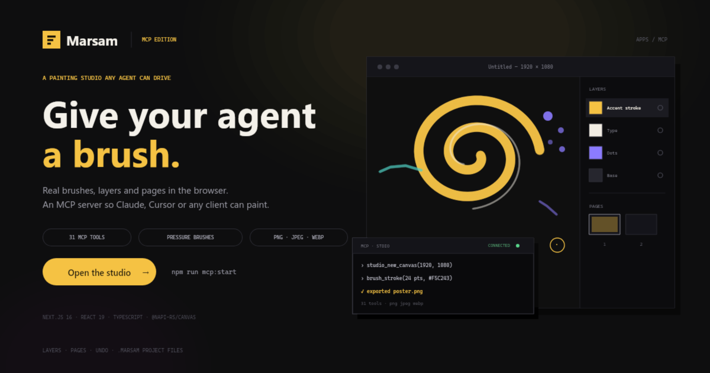
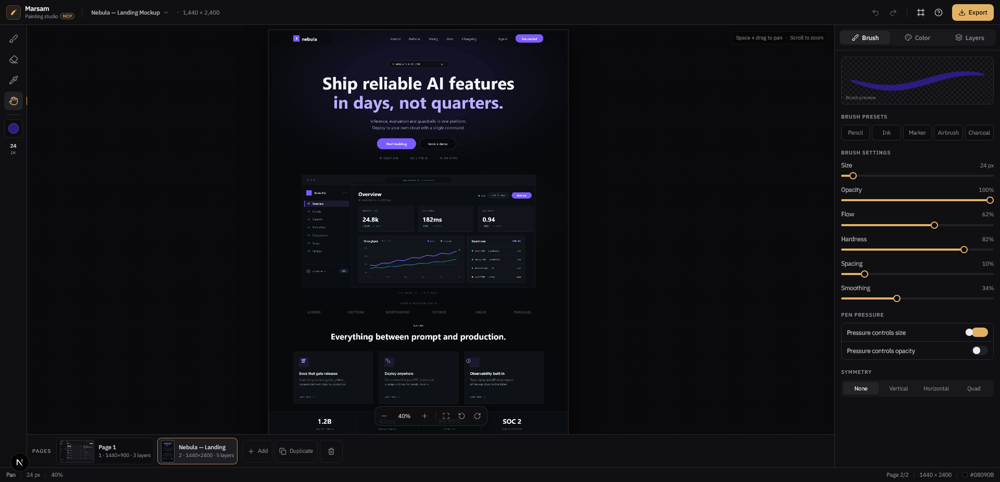

# Marsam — Painting Studio (MCP edition)



> **MCP edition.** This folder is a copy of the Marsam studio with an added
> MCP server: AI clients can paint, compose layers, preview and export through
> the Model Context Protocol. See [MCP.md](./MCP.md) for setup, client
> configuration and the tool list. The original studio in `apps/web` is not
> modified.

A professional in-browser painting app with an English (LTR) interface and a dark studio look. Built on the Next.js App Router with React, Tailwind CSS v4 and shadcn/ui-style components.



## Running

```bash
npm install
npm run dev    # http://localhost:3000
npm run build  # production build (Next.js 16 + Turbopack)
npx tsc --noEmit

npm run mcp:install   # MCP server dependencies
npm run mcp:build     # compile the MCP server
npm run mcp:smoke     # end-to-end MCP test
```

## Features

- **Canvas** with a default size of `1920 × 1080` and a changeable `#0f0f0f` background, plus presets, corner pinning vs. centering, and the choice to keep or clear artwork when resizing.
- **Professional brush** on Canvas 2D: cached radial stamps, pen pressure, mouse velocity falloff, smoothing, separate opacity and flow, and presets (Pencil, Ink, Marker, Airbrush, Charcoal).
- **Eraser** via `destination-out` and an **eyedropper** to pick a color from the artwork.
- **Symmetry**: quad, vertical or horizontal, with on-canvas guides.
- **Layers**: add, duplicate, merge down, reorder, hide, opacity, blend modes, fill/clear, and insert an image as a layer.
- **Pages**: up to 24 pages in one project, each with its own canvas size, background, layers and undo history. A page strip under the canvas adds, duplicates, renames (double-click), reorders the view and deletes pages; every page renders a live thumbnail.
- **Undo/redo** up to 30 steps per page: 256px tile snapshots for the strokes plus state snapshots for layers and canvas size.
- **View**: wheel zoom at the cursor, pan with space or the pan tool, rotation, fit to screen, and actual size.
- **Touch**: two fingers pinch to zoom, drag to pan and twist to rotate; one finger paints. A touch that turns into a pinch is discarded instead of leaving a stray mark.
- **Projects**: save the whole project (every page with its canvas, background, layers, blend modes, opacity and visibility) to a `.marsam` file, reopen it later, start a new project, and rename it. The dot next to the project name marks unsaved changes, and Marsam asks before discarding them.
- **Export**: PNG (optional transparency), JPEG, WebP — at `0.5×–4×` or a custom width, with adjustable quality for lossy formats. Export the current page or every page at once.
- **Responsive UI**: the side panel becomes a drawer on phones, and brush, color and background preferences persist in `localStorage`.

## Project files

A `.marsam` file is plain JSON. Version 2 stores a `pages` array; each page carries its own `doc` (size, background, transparency), `activeIndex` and a `layers` array with name, visibility, opacity, blend mode and pixels encoded as a PNG data URL. `activePage` remembers which page was open. Version 1 files — a single top-level `doc` plus `layers` — still open, read as a one-page project, and are saved back as version 2. Files stay readable and self-contained, but they grow with the number of pages, layers and pixels that hold content.

## Shortcuts

| Shortcut | Action |
| --- | --- |
| `B` / `E` / `I` / `H` | Brush / Eraser / Eyedropper / Pan |
| `[` / `]` | Smaller / larger brush |
| `Space` + drag | Temporary pan |
| `Alt` + click | Pick a color from the canvas |
| `Ctrl+Z` / `Ctrl+Shift+Z` or `Ctrl+Y` | Undo / redo |
| `Ctrl+0` / `Ctrl+1` | Fit to screen / 100% |
| `Ctrl+S` | Open the export dialog |
| `Ctrl+Alt+N` | New project |
| `Ctrl+O` | Open a project file |
| `Ctrl+Shift+S` | Save the project |
| Double-click | Fit to screen |
| `Esc` | Cancel the current stroke and close the mobile drawer |

Letter and digit shortcuts match both the typed character and the physical key position, so they keep working when the system keyboard layout is Arabic, Cyrillic, Greek or anything else non-Latin (the `B` key on an Arabic layout still selects the brush).

## Structure

```
app/                 LTR layout, Latin font, the page
components/studio/   Top bar, project menu, tools, stage, pages strip, side panels, dialogs
components/ui/       shadcn/ui components written by hand on top of Radix
lib/paint/studio.ts  Drawing engine: view, bounds, pages, layers, history, projects, export
lib/paint/project.ts Project file format: validation and decoding
lib/paint/brush.ts   Brush settings and the stamp cache
lib/paint/color.ts   Color conversions and the painter's palette
mcp/src/             Headless engine and MCP tools (see MCP.md)
mcp/dist/            Compiled MCP server
```

## Known limits

- Canvas size is capped at `64–6000` px and `40` million pixels per page; export goes up to `16000` px per side.
- History lives in memory only and is cleared when a project is opened or a new one starts.
- There is no autosave and no cloud storage: a project is only kept once you save it to a `.marsam` file. Reloading the page starts a new canvas (with a warning before leaving a page holding unsaved artwork).
- Project files are capped at 24 pages, 40 layers per page and 400 MB, and hold only what is needed to redraw the artwork — no history, view position or tool settings. Adding, duplicating, deleting and renaming pages is not undoable.
